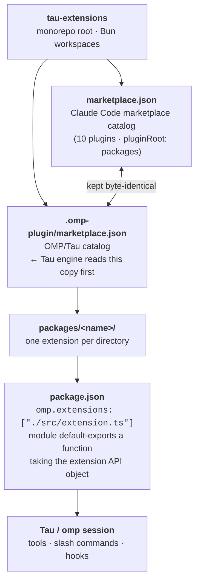

<div align="right">

[](./LICENSE)
[](https://bun.sh)
[](#extensions)

</div>

# tau-extensions

**The extension marketplace monorepo for Tau/OMP-style agents** — one repo, eleven curated extensions, a single install flow for streaming integrations, git automation, model routing, task tracking, workflow orchestration, and browser automation. Every extension plugs into a Tau/omp session through the same loader contract; one `marketplace.json` catalog serves both Claude Code-style and OMP/Tau consumers.

## Why this exists

Coding agents live or die by their extensions, but extensions scatter: some on npm, some as gists, most unmaintained. `tau-extensions` collects the ones that matter into one curated, typechecked, CI-gated monorepo — ours, plus MIT-licensed forks with upstream provenance preserved. You get:

- 🔌 **One install path** — `omp plugin link`, npm, or sparse-checkout — for every extension
- 📡 **Streaming integrations** — Kafka topics and Moonshot's kimi-code CLI surfaced as session tools
- 🤖 **Smarter model spend** — complexity-based routing across cheap/mid/expensive tiers with per-turn and session cost tracking
- ✅ **Workflow discipline** — auto-commit every edit, undo/redo session navigation, best-of-N agent sampling, named repeatable workflows
- 📋 **Coordination** — task tracking, dependency management, background task processes, and a persistent visual task widget
- 🌐 **Native browser automation** — a real `agent_browser` tool instead of brittle shell-driven scraping

## Extensions

| Extension | Version | Category | What it does |
|---|---|---|---|
| [`omp-kafka`](packages/omp-kafka) | 0.2.0 | integration | Consume Kafka topics into an omp session in auto (push) or pull mode — `/kafka-*` slash commands plus a `kafka_consume` LLM tool |
| [`omp-edit-committer`](packages/omp-edit-committer) | 0.2.0 | workflow | Auto-commit every Edit/Write with a descriptive message (intent, trade-offs, ASCII diagrams); surfaces the SHA as a badge next to the tool result, for use with `modem-dev/hunk` |
| [`omp-model-router`](packages/omp-model-router) | 0.8.9 | model-routing | Routes prompts to cheap/mid/expensive models by task complexity; tracks per-turn and session costs; TOON compression for conversation history |
| [`omp-kimi`](packages/omp-kimi) | 0.1.0 | integration | Drive Moonshot's kimi-code CLI from inside a session: `/kimi` non-interactive prompts, `/kimi-models`, `/kimi-doctor`, `/kimi-web` web UI, plus a `kimi_ask` LLM tool. Supports `KIMI_API_KEY` |
| [`pi-tasks`](packages/pi-tasks) | 0.9.0 | productivity | Claude Code-style task tracking and coordination: structured multi-step tasks, dependency management, background task processes, and a persistent visual task widget |
| [`pi-workflow`](packages/pi-workflow) | 0.13.8 | workflow | Workflow orchestration for Pi subagents: named, repeatable multi-step workflows (research, code review, spec checks) coordinating subagent workers across steps, with run inspection, stop, and resume |
| [`pi-agent-browser-native`](packages/pi-agent-browser-native) | 0.6.12 | automation | Exposes agent-browser as a native Tau tool: scripted browser automation (navigate, snapshot, act, extract) with session management, batch lifecycle, and hardened command policies |
| [`omp-best-of`](packages/omp-best-of) | 0.2.0 | agents | Best-of-N coding agents with LLM-as-a-verifier selection: runs N candidates in isolated git worktrees, ranks trajectories with a verifier model, applies only the winning patch |
| [`gsd-omp`](packages/gsd-omp) | 1.0.24 | orchestration | GSD Embeddable Orchestration System host plugin: binds the native extension, command, event, task, and filesystem surfaces to GSD via the Host-Integration SDK, with optional Goal Mode status mirroring |
| [`omp-undo-redo`](packages/omp-undo-redo) | 1.6.2 | workflow | Undo/redo session navigation for Pi and Oh My Pi |
| [`engram`](packages/engram) | 6.48.0 | memory | Private workspace package: persistent memory extension (`engram-memory.mjs`) with `memory` and `retrospective-eval` skills and `/doctor`, `/issue`, `/setup`, `/stats` slash commands |
| [`tau-flocksync`](packages/tau-flocksync) | 1.0.0 | model-routing | flocksync / OmniRoute models sync extension for Tau and sovereign agents — syncs `:25193` / `:20130` catalogs into `models.json` with `/flocksync` and `/omni` commands |

> Versions from each package's `package.json`. Eleven extensions are catalogued in `marketplace.json`; `engram` is a private workspace package (`"private": true`) and `omp-undo-redo` carries a minimal manifest entry.

## Catalog architecture

Two manifests, one catalog — kept byte-identical:



The loader contract is uniform across the monorepo (`.cjs` loader entry for `gsd-omp`; `./extensions/engram-memory.mjs` for the private `engram` package):

- `packages/<name>/` — one extension per directory
- `package.json` — declares `omp.extensions` pointing at the entry module
- `src/`, `README.md`, `LICENSE` — source, docs, license

## Quick start

```bash
git clone --depth 1 https://github.com/toxicwind/tau-extensions ~/.tau/agent/extensions/tau-extensions
cd ~/.tau/agent/extensions/tau-extensions/packages/omp-kafka && bun install
omp plugin link .
```

Swap `omp-kafka` for any extension from the table above. Requires `omp >= 17.0.0` and [Bun](https://bun.sh) 1.3.x.

<details>
<summary>Other install modes</summary>

**Sparse checkout — one extension, minimal clone:**

```bash
git clone --depth 1 --filter=blob:none --sparse https://github.com/toxicwind/tau-extensions ~/.tau/agent/extensions/tau-extensions
cd ~/.tau/agent/extensions/tau-extensions
git sparse-checkout set packages/omp-kafka
cd packages/omp-kafka && bun install
omp plugin link .
```

**npm (once published):**

```bash
bun add -g @toxicwind/omp-kafka
```

Then add to `~/.tau/agent/config.yml`:

```yaml
extensions:
  - @toxicwind/omp-kafka
```

**Load once for a single session:**

```bash
omp --extension /path/to/tau-extensions/packages/omp-kafka
```

</details>

## Config

Tau resolves extensions from `~/.tau/agent/extensions/` (global) and `<cwd>/.tau/extensions/` (project-local). Optional per-extension configuration:

| Setting | Where | Used by |
|---|---|---|
| `extensions:` list | `~/.tau/agent/config.yml` | npm-installed extensions (`@toxicwind/<name>`) |
| `KIMI_API_KEY` | environment | `omp-kimi` — authenticates the kimi-code CLI (the CLI itself is installed separately; it is not vendored) |

No other environment variables or config files are required by the monorepo. Extension-specific options live in each package's own `README.md`.

## Dev / contributing

```bash
bun install
bun run test        # bun test packages/*
bun run typecheck   # bun scripts/typecheck.mjs
bun run lint        # biome check packages/*/src
```

All packages typecheck and test cleanly — enforced in CI. Lockfiles are generated with Bun 1.3.x and CI installs with `--frozen-lockfile`.

**Adding an extension:**

1. Vendor the source under `packages/<name>/` (keep the upstream `LICENSE` file; strip `.git`).
2. Ensure `package.json` declares `omp.extensions: ["./src/extension.ts"]` whose module default-exports a function taking the extension API object.
3. Add a plugin entry to **both** marketplace manifests: `name`, `description`, `version`, `source` as `"./<name>"`, `homepage` pointing at this repo's tree URL, `license`.
4. Record provenance in [`NOTICE`](./NOTICE).
5. Run `bun install`, `bun run typecheck`, `bun test packages/<name>` before pushing.

**Rules:** never commit `node_modules/`, `dist/`, `.env`, or API keys. Forks keep their upstream LICENSE; repoint repo URLs at this monorepo but keep author attribution.

## License + security

**MIT** — see [LICENSE](./LICENSE) (© 2026 RekunDzmitry).

Vendored forks retain their upstream MIT licenses; original LICENSE files are kept in each package directory. Full fork provenance and attribution lives in [NOTICE](./NOTICE):

- `omp-kafka`, `omp-edit-committer` — derived from RekunDzmitry/omp-extensions (via the retired toxicwind/omp-extensions fork)
- `omp-model-router` — derived from cakriwut/omp-model-router
- `pi-tasks` — derived from tintinweb/pi-tasks
- `pi-workflow` — derived from AgwaB/pi-workflow
- `pi-agent-browser-native` — derived from fitchmultz/pi-agent-browser-native
- `omp-best-of` — derived from wolfiesch/omp-best-of
- `gsd-omp` — derived from tchivs/gsd-omp
- `omp-undo-redo` — vendored from Baylar55/omp-undo-redo
- `omp-kimi` — our own extension (© toxicwind); the kimi-code CLI it drives is MIT-licensed © Moonshot AI and installed separately

Security: extensions run with the full authority of the agent session they load into — browser automation, git commits, Kafka consumption, and model routing all act on your behalf. Review an extension's `src/` before linking it, and never commit API keys or `.env` files to the monorepo. Report vulnerabilities via [GitHub issues](https://github.com/toxicwind/tau-extensions/issues).
